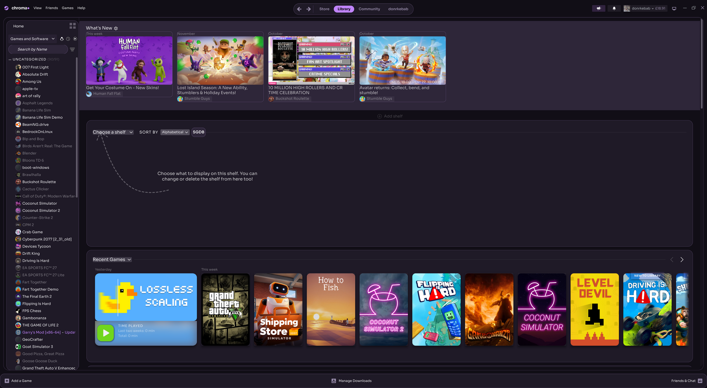
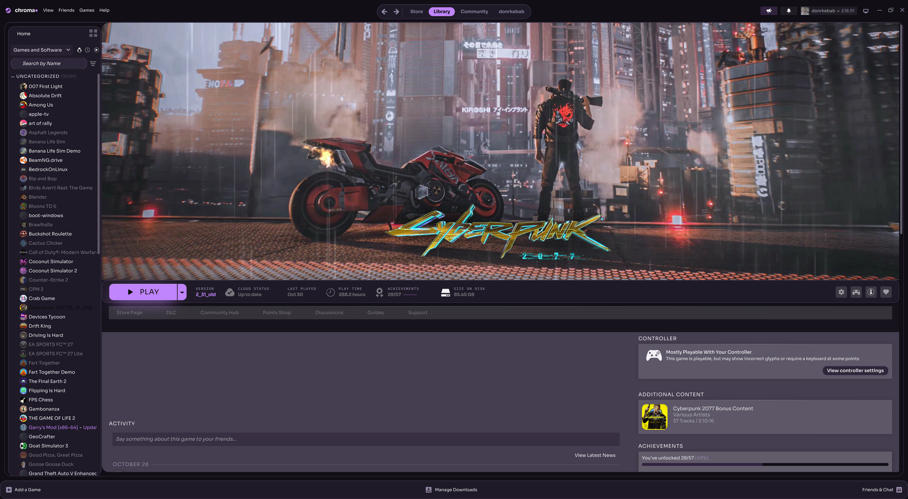
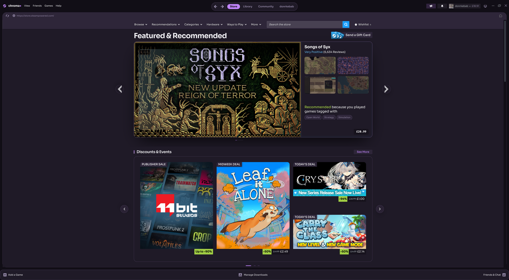

# Chroma

A Steam theme that recolours itself: the accent, panels, tabs and Play button all take on the colour of the game you are looking at, sampled live from its art.

**Includes:** library, game pages, store and community pages, friends and chat, notifications, menus, sign-in screen, downloads.

## Screenshots




## Install
Requires [Millennium](https://steambrew.app). Open Steam → Millennium → Themes → Install a theme, and paste:
```
https://github.com/ethembeldagli/steam-chroma
```

## Settings
Steam → Millennium → Themes → Chroma → ⚙
- **Accent color:** Auto (from game), Violet, Lime, Coral
- **Corners:** default, sharp, extra round
- **Motion:** full or reduced
- **Backdrop:** on or off

## License
MIT
